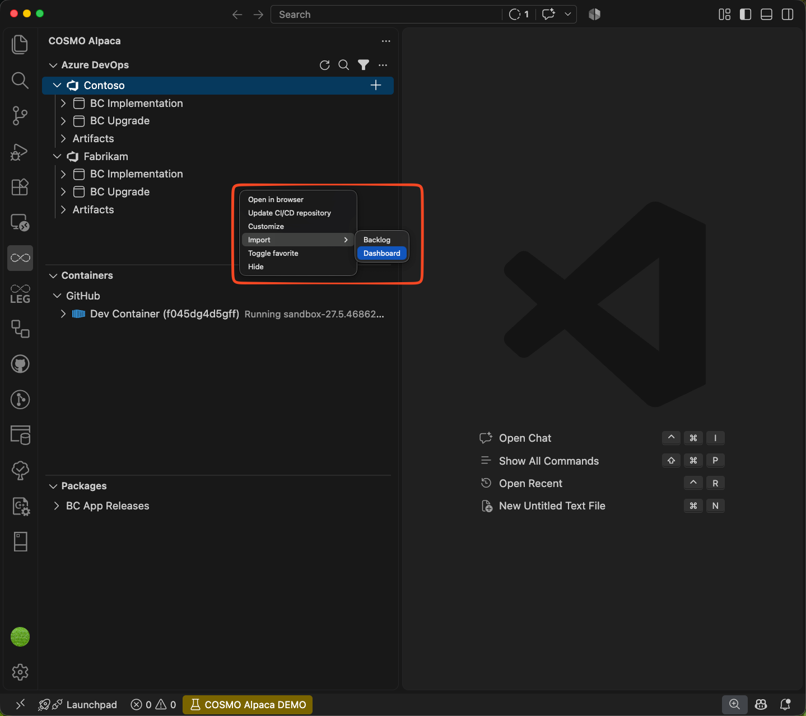
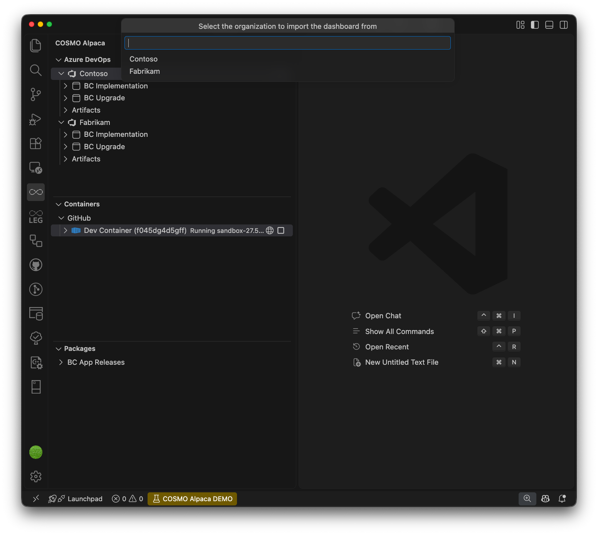
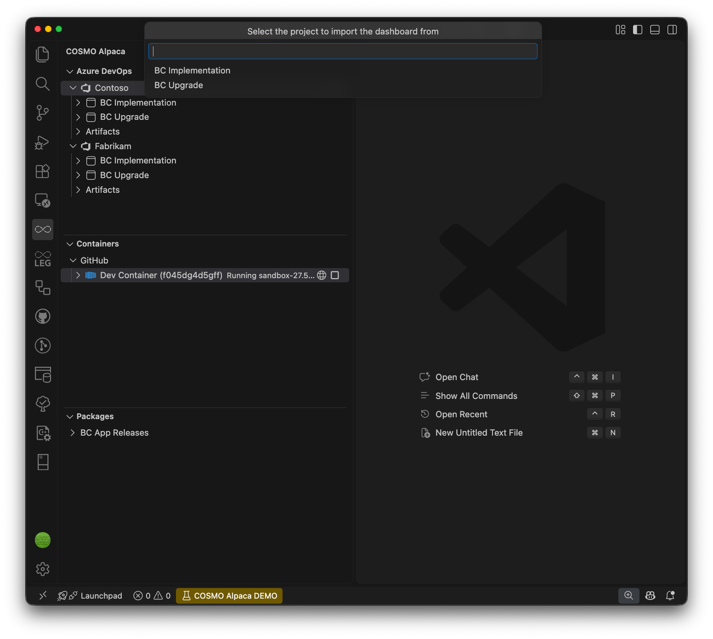
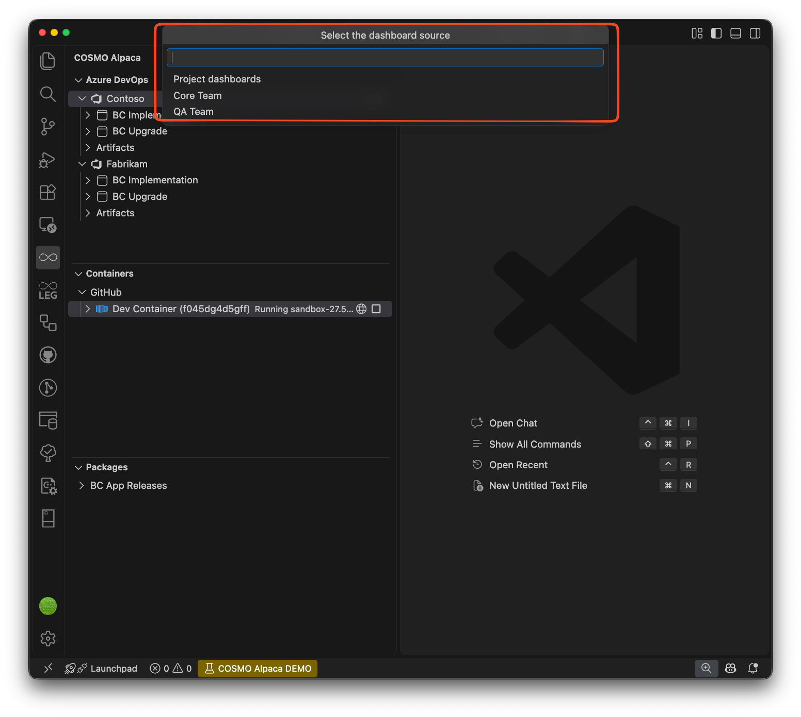
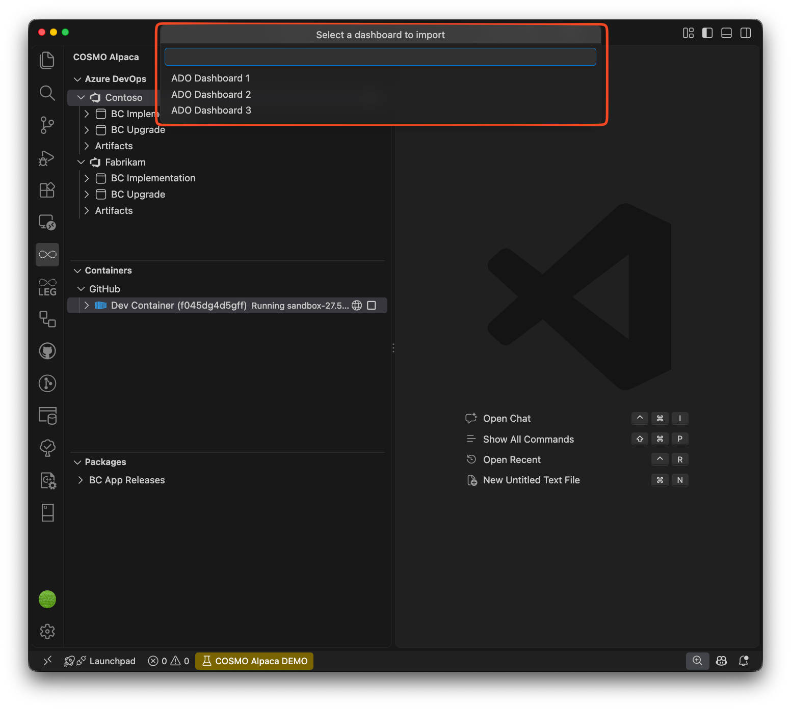
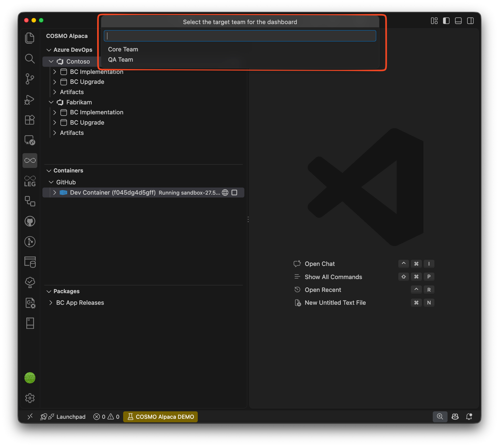

# Importing a Dashboard from Another Azure DevOps Project

The extension lets you import an existing project or team dashboard from one Azure DevOps project into another.

> [!IMPORTANT]
> The source and target projects must use the same process customization for a successful dashboard import ([customize project](customize-project.md)).

---

## How to Import a Dashboard

### 1. Open the Import Dashboard Dialog

Right-click the target project in the **Azure DevOps** view where you want to import the dashboard, then select **Import > Dashboard**.

### 2. Select the Source Organization

A dialog will appear asking you to select the organization that contains the dashboard you want to import.  
Choose the appropriate organization from the list.

### 3. Select the Source Project

After selecting the organization, the extension will prompt you to select a project within that organization.  
Choose the project that contains the dashboard you wish to import.

### 4. Select the Dashboard Source

Choose **Project dashboards** to import a project dashboard, or select a team to import one of its team dashboards.

### 5. Select the Dashboard

Choose the dashboard to import from the selected source.

### 6. Select a Target Team (for team dashboards only)

When importing a team dashboard, select an existing team in the target project. The target-team picker is skipped for project dashboards, which remain project-scoped.

Dismiss the target-team picker to cancel the import. After you confirm the selections, a progress notification is displayed in VS Code while the dashboard is imported.

Widget queries are adjusted for the target project. Team dashboards are imported into the selected existing target team; project dashboards are imported at project scope.