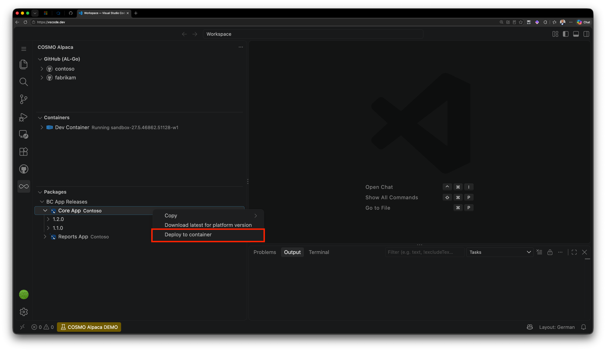

# Deploy Artifact to Container

You can deploy a NuGet package or an Azure DevOps Artifact directly to a running container from the **Packages View** in the COSMO Alpaca extension.

## Prerequisites

- The target container must be running and ready.
- You must have access to the feed that contains the artifact.
- The artifact must be compatible with the Business Central version in the target container.

## Deploy the latest or a specific artifact version

1. Open the **Packages View** in the COSMO Alpaca extension.
1. Right-click the package or the specific version and select **Deploy to container**.
1. Select the target container.
1. Confirm the deployment.

If no specific version was selected, the latest available version is downloaded and installed.

The extension shows the deployment progress and notifies you when the deployment is complete.

## Planned: Deploy Multiple Artifacts

The following workflow is planned and is not available yet. It depends on coordinated updates to the COSMO Alpaca API, container scripts, and VS Code extension.

The planned **Batch Deployment** view will let you combine local artifact files, NuGet packages, and Azure DevOps packages in one deployment. You will be able to select package versions, remove artifacts from the batch, and choose automatic dependency ordering or arrange the artifacts manually. A **Deploy local artifacts** action will also let you select and upload multiple local files.

The batch will use shared deployment options:

- **Deployment scope**: Global, Tenant, or Dev.
- **App synchronization**: Add or ForceSync.
- **NuGet options**: Choose package versions and optionally consider apps already installed in the container when resolving packages and dependencies.
- **Uploaded-file cleanup**: Choose whether uploaded files are retained after deployment.

Deployments will run asynchronously. The extension will show progress while it checks the execution status, then display the deployment output and report whether it completed or failed. Running containers will also show their installed non-Microsoft apps, including each app's version, publisher, and ID.

### Availability and rollout requirements

This workflow requires an API that supports the new artifact-deployment request and execution-status reporting, plus container scripts that stage and deploy the artifacts and discover installed apps. The API change removes the older deployment route used by existing extension versions, so backward compatibility or a coordinated migration is required before rollout. Until the API, container scripts, and extension updates are available together, continue using the current single-package workflow described above.